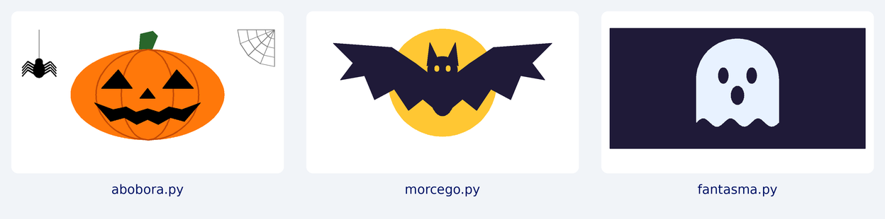

# MicroPython | CASIO Educação

Atividades de programação e matemática para explorar desenhos na calculadora gráfica CASIO fx-CG100.

A coleção começa com **Halloween matemático**: três programas que conectam a construção de figuras a coordenadas, simetria, elipses e funções trigonométricas. Cada arquivo funciona de forma independente e pode ser estudado, modificado e usado como ponto de partida em uma atividade de aula.

*Prévia gerada em computador a partir dos segmentos dos programas. As cores, as espessuras e a velocidade podem diferir na calculadora.*

## Comece por aqui

1. Escolha um programa na tabela abaixo;
2. Baixe o arquivo `.py`. No GitHub, abra o arquivo e use a opção de download do arquivo original. Evite salvar a página HTML;
3. Transfira o arquivo para a calculadora e execute no app Python, conforme o [guia de execução](docs/execucao.md);
4. Modifique um parâmetro por vez e compare os resultados.

## Halloween matemático

| Programa | O que aparece | Conceitos explorados |
| --- | --- | --- |
| [abobora.py](exemplos/halloween/abobora.py) | Abóbora, teia e aranha | Elipses, coordenadas relativas, simetria e geometria polar |
| [morcego.py](exemplos/halloween/morcego.py) | Morcego diante da lua | Reflexão no eixo vertical, escala e polígonos |
| [fantasma.py](exemplos/halloween/fantasma.py) | Fantasma com base ondulada | Semicircunferência, seno, amplitude e número de oscilações |

Os arquivos usam nomes curtos, sem espaços e sem acentos. Os comentários dentro dos programas também usam caracteres ASCII para facilitar a transferência e a edição entre ambientes.

## Ambiente previsto

- Calculadora gráfica CASIO fx-CG100 com o app Python disponível;
- Módulos `math` e `turtle` fornecidos pelo ambiente da calculadora;
- Cabo USB com transferência de dados para copiar os arquivos a partir do computador.

Não há pacotes externos para instalar na calculadora. A implementação de Python e os recursos gráficos podem variar entre modelos e versões do sistema. A compatibilidade com outras calculadoras precisa ser verificada separadamente.

**Estado da validação:** os programas passaram por verificação de sintaxe e execução local com registro de comandos gráficos. A execução no equipamento físico e no emulador da CASIO permanece pendente. O registro local verifica a lógica dos desenhos, mas não reproduz o interpretador, o desempenho ou a interface da calculadora.

## Para professores e estudantes

O desenho oferece um resultado visual para investigar o efeito de cada alteração. Antes de executar, formule uma hipótese: qual parte da figura deve mudar e por quê?

Consulte as propostas de atividade no [roteiro pedagógico](docs/atividades.md). Para entender o preenchimento das figuras e a escolha das coordenadas, veja as [notas técnicas](docs/notas-tecnicas.md).

## Organização

| Local | Conteúdo |
| --- | --- |
| `exemplos/halloween/` | Programas independentes para copiar para a calculadora |
| `docs/` | Guias de execução, atividades, notas técnicas e publicação |
| `assets/` | Prévia visual da coleção |
| `tools/` | Verificação local dos programas no computador |
| `.github/` | Modelos de contribuição e automação de verificação |

Novas coleções podem ser acrescentadas dentro de `exemplos/`, mantendo o tema de Halloween nesta primeira pasta.

## Contribuições

Sugestões de atividades, melhorias e relatos de execução são bem-vindos. Consulte [CONTRIBUTING.md](CONTRIBUTING.md). Ao relatar um problema, informe o modelo da calculadora, a versão do sistema, o arquivo utilizado e a mensagem exibida.

## Licenciamento

Esta versão ainda não define uma licença de distribuição. A licença deve ser escolhida e aprovada pela organização responsável antes da publicação. A disponibilidade pública do código, por si só, não concede uma licença aberta de uso, modificação ou redistribuição.

## Documentação de referência

- [Suporte oficial CASIO para calculadoras](https://support.casio.com/pt/support/calculators/);
- [Manuais da CASIO fx-CG100](https://support.casio.com/global/pt/calc/manual/fx-CG100/).

Consulte o manual correspondente ao modelo e à versão do sistema utilizado.
